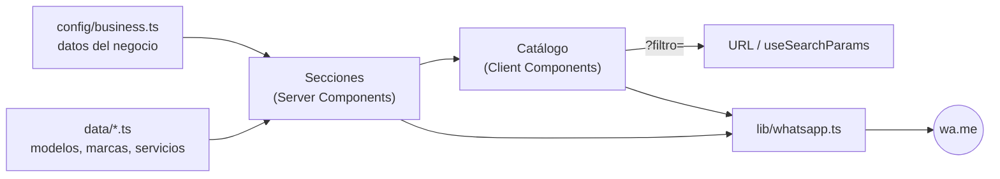

# Centro Óptico Ale Domesi — Sitio web

Demo comercial del sitio de **Centro Óptico Ale Domesi**, una óptica que necesitaba presencia digital sin venta online. El sitio funciona como vidriera: muestra anteojos, servicios e información del local, y deriva cada consulta a WhatsApp con un mensaje ya armado.

No es un e-commerce: no hay carrito, precios, checkout ni pagos.


## Características

- **Catálogo con filtros**: Todos, Sol, Recetados, Clásicos y Modernos. El filtro activo se guarda en la URL (`?filtro=sol`), así se puede compartir un enlace ya filtrado.
- **Ficha de cada modelo**: imagen, marca, categoría, descripción, características y botón de consulta. En celular se abre como bottom sheet con el botón siempre visible; en escritorio, como modal centrado.
- **Consultas por WhatsApp**: mensajes generados desde una sola función, por ejemplo *"Hola! Quería consultar por el modelo Atelier Solare Riviera."*
- **Colección por categorías**: cada tarjeta lleva al catálogo con el filtro correspondiente aplicado.
- **Secciones institucionales**: hero, servicios, sección editorial ("Nosotros"), beneficios, grilla de Instagram, contacto con horarios y botón "Cómo llegar" a Google Maps.
- **Mobile first**: menú lateral animado, carrusel nativo con scroll-snap y botón flotante de WhatsApp.
- **Accesibilidad**: HTML semántico, foco atrapado en modales y menú, cierre con Escape o clic afuera, restauración del foco, enlace "Saltar al contenido" y respeto de `prefers-reduced-motion`.
- **SEO**: metadata, Open Graph, `robots.txt`, `sitemap.xml`, manifest e ícono, y datos estructurados `schema.org/Optician`.

## Stack

| Área | Tecnología |
| --- | --- |
| Framework | Next.js 16 (App Router, Turbopack) |
| UI | React 19, TypeScript 5 (modo `strict`) |
| Estilos | Tailwind CSS 4 con tokens de marca en variables CSS |
| Animaciones | Motion (`LazyMotion` + `domAnimation`) |
| Íconos | Lucide React; WhatsApp e Instagram como SVG propios |
| Tipografías | Cormorant Garamond y Manrope vía `next/font` |
| Calidad | ESLint 9 (`eslint-config-next`) y `tsc --noEmit` |

No usa base de datos ni backend: todo el contenido vive en archivos TypeScript y la página se genera estática en el build.

## Arquitectura

La página se renderiza en el servidor y sólo los componentes que necesitan interacción son Client Components: header y menú móvil, catálogo (filtros y modal) y los wrappers de animación. El hero y el botón flotante usan animaciones CSS, sin JavaScript.



El catálogo se renderiza completo en el HTML estático (fallback de `Suspense`). Al hidratar, `CatalogController` lee el filtro de la URL y lo actualiza con `history.replaceState`, que Next.js sincroniza con `useSearchParams`.

## Estructura del proyecto

```text
src/
├── app/            # layout, página, estilos globales, fuentes, robots, sitemap, manifest, ícono
├── components/
│   ├── catalog/    # filtros, tarjetas, modal y sincronización con la URL
│   ├── layout/     # header, menú móvil, footer, botón flotante, MotionProvider
│   ├── sections/   # hero, colección, catálogo, servicios, editorial, beneficios, Instagram, contacto
│   ├── seo/        # datos estructurados JSON-LD
│   └── ui/         # botones, títulos de sección, animaciones Reveal, íconos de marca
├── config/         # business.ts: configuración central del negocio
├── data/           # modelos, marcas, categorías, filtros, servicios, beneficios, Instagram
├── hooks/          # useDialogBehavior (modales accesibles), useActiveSection
├── lib/            # whatsapp, maps, scroll, motion, utils
└── types/          # tipos del catálogo (Glasses, Brand, Category, Service…)
public/images/      # imágenes optimizadas por next/image
```

## Requisitos

- Node.js 20.9 o superior
- npm

## Instalación y ejecución

```bash
git clone https://github.com/EnzoDalmasso/CentroOptico.git
cd CentroOptico
npm install
npm run dev
```

El sitio queda en `http://localhost:3000`.

| Comando | Descripción |
| --- | --- |
| `npm run dev` | Servidor de desarrollo |
| `npm run build` | Build de producción |
| `npm run start` | Sirve el build de producción |
| `npm run lint` | ESLint |
| `npm run typecheck` | Chequeo de tipos con TypeScript |

### Variables de entorno

| Variable | Requerida | Uso |
| --- | --- | --- |
| `NEXT_PUBLIC_SITE_URL` | No | URL pública del sitio. Se usa en canonical, Open Graph, sitemap, robots y datos estructurados. Si no se define, toma el valor por defecto de `src/config/business.ts`. |

## Personalización

El proyecto está pensado para reutilizarse con otros comercios cambiando datos, no componentes.

| Qué | Dónde |
| --- | --- |
| Nombre, WhatsApp, Instagram, dirección, horarios, textos del hero, SEO | `src/config/business.ts` |
| Modelos de anteojos | `src/data/glasses.ts` + imágenes en `public/images/products/` |
| Marcas | `src/data/brands.ts` |
| Categorías de la colección | `src/data/categories.ts` |
| Servicios y beneficios | `src/data/services.ts`, `src/data/benefits.ts` |
| Grilla de Instagram | `src/data/instagram.ts` |
| Colores y tipografías | `src/app/globals.css`, `src/app/fonts.ts` |
| Textos de los mensajes de WhatsApp | `src/lib/whatsapp.ts` |
| Video del hero (opcional) | `hero.video` en `src/config/business.ts` |

Ejemplo de un modelo nuevo:

```ts
// src/data/glasses.ts
{
  id: "aurora",
  name: "Aurora",
  brandId: "nordvik",
  type: "recetados",   // "sol" | "recetados"
  style: "moderno",    // "clasico" | "moderno"
  image: { src: "/images/products/aurora.jpg", alt: "Armazón de metal dorado" },
  tagline: "Liviano y luminoso",
  description: "…",
  features: ["Metal liviano", "Apto para cristales recetados"],
  tags: ["Metal", "Unisex"],
}
```

## Datos de la demo

- **Dirección y horarios** son placeholders (`isPlaceholder: true`) y el sitio los muestra con la etiqueta "A confirmar". Al cargar los datos reales, cambiar a `false`; recién ahí la dirección se incluye en los datos estructurados.
- **WhatsApp** es el número publicado en la bio de Instagram del local.
- **Modelos y marcas** son ficticios.
- **Imágenes**: fotografías de [Unsplash](https://unsplash.com) (licencia Unsplash), de uso ilustrativo.

## Deploy

El proyecto se despliega en Vercel sin configuración extra: importar el repositorio y, opcionalmente, definir `NEXT_PUBLIC_SITE_URL` con el dominio final.

## Autor

**Enzo Dalmasso**

- GitHub: [@EnzoDalmasso](https://github.com/EnzoDalmasso)
- Portfolio: [porfolio-enzo-dalmasso.vercel.app](https://porfolio-enzo-dalmasso.vercel.app/)
